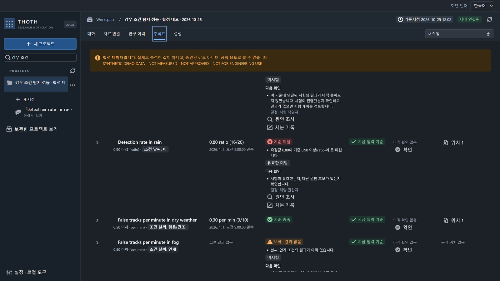
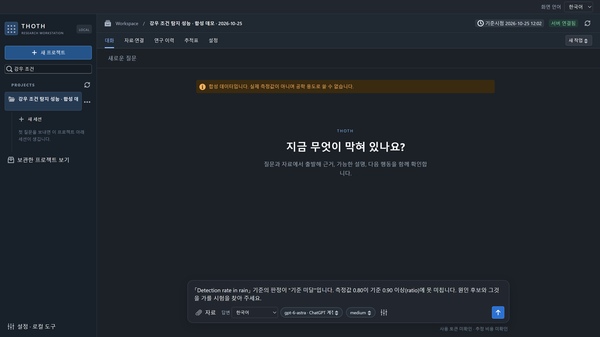
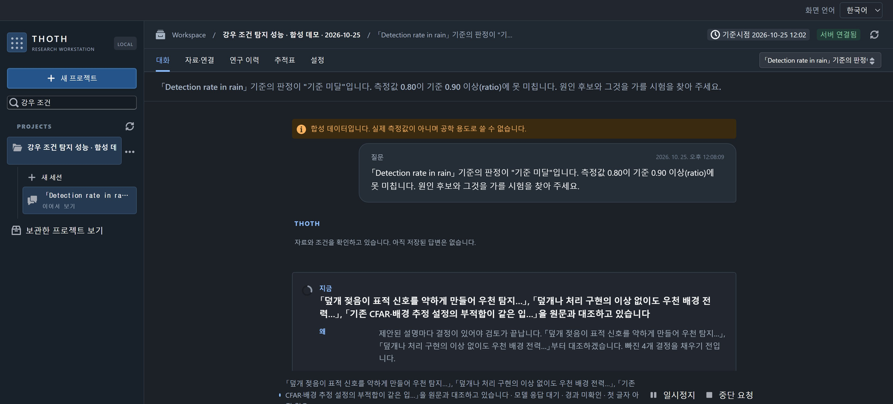
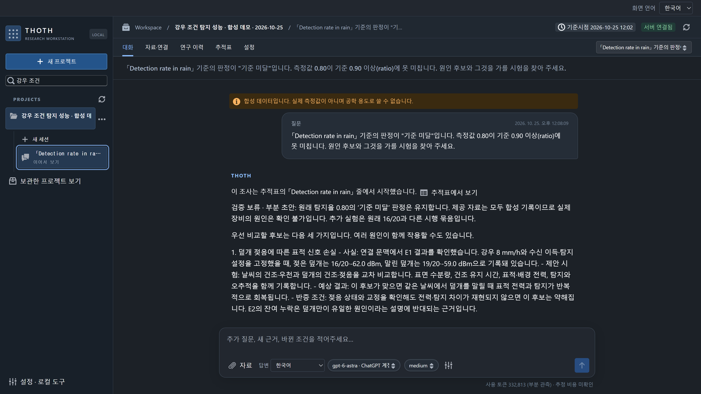
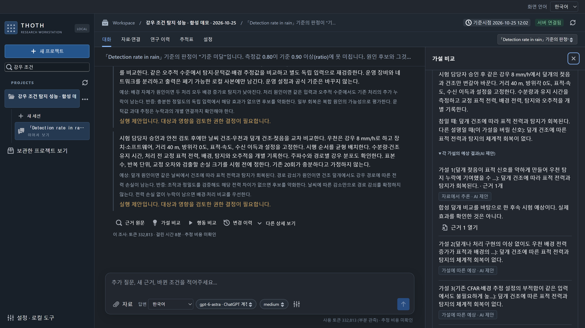
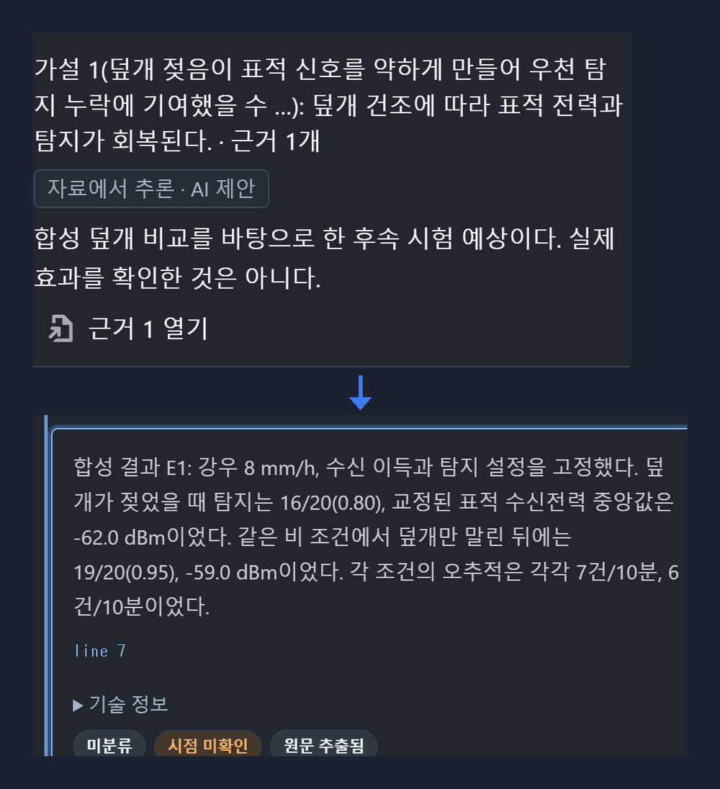
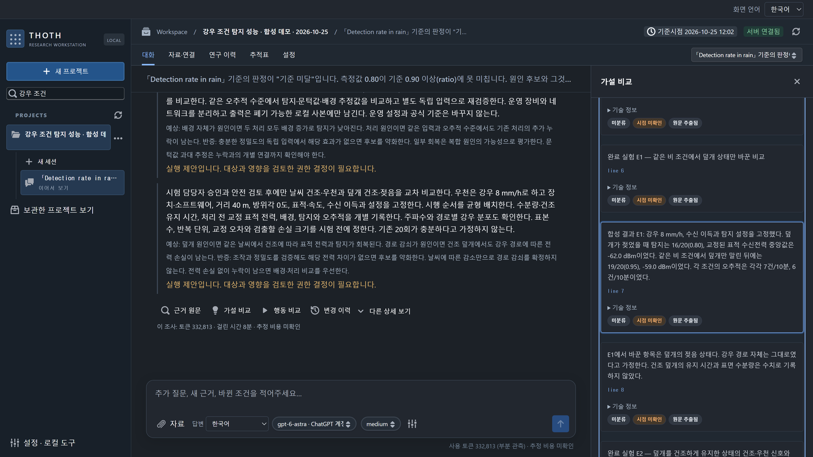

<p align="center">
  
</p>

<h1 align="center">THOTH</h1>

<p align="center">
  <strong>근거를 따라, 판단의 변화를 남기다.</strong><br>
  Follow the evidence. Keep the history of your judgment.
</p>

<p align="center">
  <sub>토티를 소개합니다. 궁금한 건 많고, 찾은 근거는 꼭 적어두는 작은 따오기예요.</sub>
</p>

<p align="center">
  <a href="LICENSE"></a>
  <a href="#현재-상태"></a>
  <a href="docs/INSTALL.md"></a>
</p>

<p align="center">
  <a href="#빠른-시작">시작하기</a> ·
  <a href="#실제-화면">실제 화면</a> ·
  <a href="#무엇을-할-수-있나요">주요 기능</a> ·
  <a href="docs/VERIFICATION.md">검증 기록</a> ·
  <a href="CONTRIBUTING.md">기여하기</a><br>
  <a href="README.md">English</a> · <strong>한국어</strong>
</p>

---

자료가 바뀌고, 결과가 수정됩니다. 함께 일하는 사람은 그 이유를 알아야 합니다.

**THOTH는 연구 질문, 원문 근거, 경쟁 가설, 저장된 결과를 연결하는 로컬 AI 연구 워크벤치입니다.**
판단을 뒷받침하는 근거와 아직 풀리지 않은 문제를 살펴보고, 저장된 두 결과를 비교하며 다음 행동을 정합니다.

> [!NOTE]
> **개인·로컬 사용을 위한 실험적 소스 공개본입니다.** 화면은 한국어·영어를 지원합니다.
> GitHub Actions에서 Python 시험, 웹 시험·빌드, 검토된 기준선을 사용하는 Python 타입 검사를 실행합니다.
> 합성 데모에서 실제 모델 조사를 끝까지 실행한 기록이 있습니다. 답의 품질이나 실제 자료에서의 유용성을 입증한 것은 아닙니다.
> 영어 질문·답변·근거 원문을 담은 화면이 있습니다. 전반적인 영어 답 품질, 실계정 연결, 실제 PC 재시작 검증은 일부가 남아 있습니다.
> 사용 전에 [현재 상태와 한계](#현재-상태), [모델 사용량과 비용](#모델-사용량과-비용), [보안 정책](SECURITY.md)을 확인하세요.

## 실제 화면

함께 들어 있는 [합성 레이더 데모](examples/synthetic-radar-demo-v1)에 한국어 합성 완료 실험 자료를
추가해 2026-10-25 조사한 화면입니다. 자료는 지어낸 기록이며 실제 측정값이나 장비 성능의 증거가 아닙니다.

<table>
  <tr>
    <td width="50%"></td>
    <td width="50%"></td>
  </tr>
  <tr>
    <td><b>1 · 결과가 기준에 못 미칩니다.</b> 판정은 규칙으로 계산합니다. 0.80은 0.90 이상이라는 기준에 못 미칩니다.</td>
    <td><b>2 · 그 줄에서 원인을 묻습니다.</b> “원인 조사”를 누르면 결과와 기준이 담긴 질문이 채워집니다. 보내기를 눌러야 조사가 시작됩니다.</td>
  </tr>
  <tr>
    <td></td>
    <td></td>
  </tr>
  <tr>
    <td><b>3 · 원문 검토 과정을 봅니다.</b> 진행 화면에서 자료와 대조 중인 원인 후보 세 개를 확인합니다.</td>
    <td><b>4 · 미해결 판단을 드러냅니다.</b> 부분 답변은 원래 판정을 유지하고, 가능한 원인과 제안한 시험을 나눠 보여 줍니다.</td>
  </tr>
  <tr><td colspan="2"></td></tr>
  <tr><td colspan="2"><b>5 · 가설을 나란히 비교합니다.</b> 설명이 다르면 시험에서 어떤 결과를 예상하는지, 그 예상이 자료와 어떻게 연결되는지 살펴봅니다.</td></tr>
  <tr><td colspan="2" align="center"></td></tr>
  <tr><td colspan="2"><b>6 · 추론에서 원문으로 이어갑니다.</b> 가설과 근거의 상세 화면 두 개를 이어 배치했습니다. 합성 실험 E1의 비교 기록이 다음 시험에서도 같은 결과가 나옴을 입증하지는 않습니다.</td></tr>
  <tr><td colspan="2"></td></tr>
  <tr><td colspan="2"><b>7 · 앞뒤 맥락도 확인합니다.</b> 원문 카드와 이웃한 줄을 함께 읽습니다. 합성 기록과 실제로 검증된 결과를 구분합니다.</td></tr>
</table>

## 무엇을 할 수 있나요

| 근거를 따라갑니다 | 판단을 검토합니다 | 변화를 남깁니다 |
| :--- | :--- | :--- |
| 문서를 연결하고 원문 위치, 자료 버전, 시점의 적격성을 살펴봅니다. | 답변과 함께 경쟁 가설, 부족한 근거, 다음 행동을 검토합니다. | 저장된 두 결과를 정확히 골라 비교합니다. 지원되는 복원은 기존 기록을 지우지 않고 새 버전으로 남깁니다. |

**이전 결과를 보존하면서 질문을 이어갑니다.** 작업이 실행 중이면 새 입력을 대기시킬 수 있으며, 재전송과 복구에서도 요청의 정체성을 유지합니다.

**미해결 상태를 드러냅니다.** 처리가 끝나도 답변은 부분적일 수 있고 판단은 보류될 수 있습니다. 처리 완료와 근거 충족을 구분합니다.

**사용할 연결을 직접 고릅니다.** 로컬 작업 공간에서 지원되는 로그인 또는 API 키를 설정하고 모델과 추론 수준을 선택합니다. 저장된 선택을 유지하며, 지원되지 않는 경로는 명시합니다. 저장된 결과나 비교를 읽는 것만으로 새 모델 호출이 시작되지는 않습니다.

**화면 언어와 답변 언어를 따로 고릅니다.** 화면 언어만 바꾸면 모델을 호출하지 않고 저장된 답변도 바꾸지 않습니다. 접수된 질문은 재시도·복구 중에도 원래 답변 언어를 유지하며, 같은 대화의 다음 질문부터 다른 언어를 선택할 수 있습니다. 옛 요청은 기존 언어 정책을 유지합니다. 새 질문을 보내면 모델 사용량이 발생합니다.

## 다시 살펴볼 수 있는 연구 흐름

가설별 예상 결과와 기각 조건은 저장된 선택이 없는 프로젝트에서 기본으로 켜집니다.
이전에 꺼서 저장한 설정은 그대로 유지되며, 프로젝트의 고급 설정에서 바꿀 수 있습니다.
빈 예측을 채우는 추가 모델 호출과 토큰 사용이 생길 수 있습니다. 근거를 연결한 예측도
확인 전에는 미확정 제안입니다.

| 단계 | THOTH에서 하는 일 |
| :--- | :--- |
| **1 · 질문** | 연구 질문을 만들고 관련 문서를 연결합니다. |
| **2 · 검토** | 답변의 원문 근거를 확인하고 경쟁 가설과 부족한 정보를 살펴봅니다. |
| **3 · 이어가기** | 자료나 후속 질문을 추가합니다. 실행 중인 작업 뒤에 입력을 대기시킬 수 있습니다. |
| **4 · 비교** | 저장된 두 결과를 골라 무엇이 달라졌는지 확인하고, 필요하면 이력을 다시 살펴봅니다. |

## 빠른 시작

**Windows · 소스 체크아웃 · Python 3.12 또는 3.13 · [uv](https://docs.astral.sh/uv/) · Node.js · pnpm**

Git으로 저장소를 내려받는다면 다음 명령을 실행합니다.

```powershell
git clone https://github.com/hyperdrivebeep/thoth.git
cd thoth
```

GitHub의 **Code → Download ZIP**으로 받았다면 압축을 풀고 `thoth-main` 폴더에서 PowerShell을
엽니다. 압축을 푼 상위 폴더에 있다면 `cd thoth-main`을 실행하세요.

**1. Python을 확인하고 잠금 파일에 맞춰 의존성을 설치합니다.** 저장소 폴더에서 실행하세요.

```powershell
$thothPython = Join-Path $env:LOCALAPPDATA 'Programs\Python\Python313\python.exe'
Test-Path -LiteralPath $thothPython
& $thothPython -m venv --copies --without-pip .venv
uv sync --python .\.venv\Scripts\python.exe --no-managed-python --no-python-downloads --frozen --extra dev --dev
pnpm.cmd install --frozen-lockfile
```

`Test-Path`가 `False`를 출력하면 공식 Python을 먼저 설치하세요. 서명 확인을 포함한 절차는
[Windows Python 준비](docs/INSTALL.md#prepare-python-on-windows)에 있습니다.

Python을 다른 경로에 설치했다면 위 `$thothPython`을 설치한 `python.exe` 경로로 바꿉니다.

**2. 첫 번째 터미널에서 API를 시작합니다.**

```powershell
.\.venv\Scripts\python.exe -m thoth.cli workspace
.\.venv\Scripts\python.exe -m thoth.cli serve --port 8765
```

**3. 두 번째 터미널에서** 같은 `thoth` 또는 `thoth-main` 폴더로 이동한 뒤 웹 화면을 시작합니다.

```powershell
pnpm.cmd --dir apps/web run dev
```

**4. 앱 안에서 모델을 연결합니다.** **<http://127.0.0.1:5173/>**을 열면 처음 설정 화면에 ChatGPT·Claude·xAI가
표시됩니다. 원하는 서비스의 로그인 버튼을 눌러 브라우저에서 로그인을 마치면 THOTH가 그 계정의 모델 목록을
불러옵니다. 본인의 API 키로 연결할 수도 있으며, 이 단계에는 터미널이 필요 없습니다.
필요한 도구(ChatGPT의 Codex CLI, Claude의 Claude Code)가 없으면 카드에 자동 설치 버튼이 나옵니다.
Node.js가 필요하고 `%LOCALAPPDATA%\THOTH\tools`에만 설치하며, 전역 설치나 다른 프로그램의 로그인은 건드리지 않습니다.
수동 명령은 [docs/INSTALL.md](docs/INSTALL.md)에 있습니다. 계정 로그인은 그 계정의 다른 앱과 사용량 한도를 함께 쓰고,
실제 호출에는 해당 서비스의 사용량이 소모될 수 있습니다.

새 Windows 설치의 연구 데이터는 소스 폴더와 별개인 `%LOCALAPPDATA%\THOTH`에 저장됩니다.
이전 버전을 사용했다면 `serve --workspace "C:\기존경로\.thoth-local" --port 8765`로
원래 데이터 폴더를 지정하세요. 시작할 때 실제 저장 위치를 표시하며, 기존 자료를 자동 이동하지 않습니다.
작업 공간 하나는 한 번에 THOTH 프로세스 하나만 사용합니다. 같은 작업 공간에서 두 번째로 시작하면
첫 번째를 닫을 때까지 안내 문구와 함께(종료 코드 3) 멈춥니다.

로컬 작업 공간이 동기화·네트워크·Windows/WSL 공유 폴더로 확인되면 실행을 막습니다(종료 코드 4).
위치를 판단하지 못하면 명시적인 확인이 필요하며(종료 코드 5), 이동식 드라이브에는 경고를 표시합니다.
`thoth workspace`로 위치를 확인하고 [위치 정책과 확인 명령](docs/INSTALL.md#workspace-location-policy)을 읽어주세요.
확인이 필요할 때는 `thoth accept-location --workspace "작업 공간 경로"`를 실행합니다.
이 확인은 안전 인증이 아니며, 알려진 차단 폴더를 허용하지 않습니다.

로그인은 THOTH 전용 프로필을 사용하며, 다른 프로그램의 기존 로그인 정보는 가져오지 않습니다.
Claude 로그인은 그 프로필에서 공식 Claude Code를 실행하고, xAI는 기기 코드 로그인을 사용합니다.
둘 다 가짜 제공자·가짜 실행 파일로만 확인했고(xAI는 Chrome/RPC 흐름도 통과), 실계정 검증은 아직 남아 있습니다.
[연결 조건과 재시작 안내](docs/INSTALL.md)를 확인하세요.

API는 로컬 루프백 주소에 바인딩되고, Vite는 API 요청을 8765 포트로 전달합니다. 소스와 migration 디렉터리를 함께 사용해야 하며, 이 공개본은 독립 wheel 설치를 지원하지 않습니다.

<details>
<summary><strong>설치 환경과 선택적 연동</strong></summary>

격리된 Windows 검증에는 Python 3.13.15, Node 24.19.0, pnpm 12.6.0, uv 0.12.5를 사용했습니다.
기본 PDF 처리는 pypdf를 사용합니다. 구조화 PDF, 브라우저 수집, 추가 커넥터, 관리형 샌드박스는 별도 의존성과 실행 조건이 있습니다.

기본 연결은 다른 프로그램의 인증 정보를 가져오지 않습니다. 실험적인 Codex 연결은 자체 프로필로 로그인·토큰 갱신·모델 목록 조회를 수행합니다. 계정 설정은 저장소에 배포하지 않으며, 로그인 확인만으로 실제 모델 응답 성공을 보장하지 않습니다.

자세한 내용은 [설치와 인증 안내](docs/INSTALL.md)를 확인하세요.

</details>

## 모델 사용량과 비용

기록된 합성 데모에서는 조사 한 번에 **모델 호출 약 8~9회, 토큰 약 33만~45만 개**를 사용했고,
대부분은 입력 토큰이었습니다. 모든 질문의 예상 사용량을 뜻하지는 않습니다.
자료 양, 모델 동작, 후속 작업에 따라 달라질 수 있습니다.

ChatGPT/Codex 로그인은 해당 계정의 구독 사용량 한도를 사용합니다. API 키 연결은 사용 토큰과
적용 요금에 따라 공급자가 과금하며, THOTH는 고정 금액을 안내하지 않습니다.
저장된 결과 아래의 사용량 표시를 확인하세요. 사용량을 모르거나 일부만 관측했으면 그대로 표시하며,
화면의 추정 비용은 공급자의 청구서가 아닙니다. [사용량·비용 안내](docs/INSTALL.md#model-usage-and-cost)도 확인하세요.

## 현재 상태

이 저장소는 **실험적 소스 공개본**입니다. 검증 결과는 확인한 소스 버전과 장면에 한정됩니다.

| 근거 | 확인한 범위 |
| :--- | :--- |
| 여기서 확인한 최신 병합 검사: [PR #25](https://github.com/hyperdrivebeep/thoth/pull/25), 2026-10-25 | 해당 [CI 실행](https://github.com/hyperdrivebeep/thoth/actions/runs/40156740267)의 최종 결과는 Python 5,828개 통과, 실패·오류 0개, 제외 2개입니다. 웹 시험·lint·타입 검사·빌드·빠른 시작 확인도 통과했습니다. 이 실행은 첫 시도에서 통과했습니다. 다른 버전에서 기록한 과거 실패를 지우는 결과는 아닙니다. |
| Python 정적 타입 | 검토된 기준선에 없는 진단을 CI에서 차단합니다. 기준선에 남은 진단이 있으므로 통과가 타입 오류 0개를 뜻하지는 않습니다. |
| 실제 모델 합성 데모 | 저장된 답변, 예상 결과 표, 근거 연결까지 생성한 기록이 있습니다. 합성 입력과 처리 완료가 과학적 결론의 타당성을 입증하지는 않습니다. |
| 로그인과 복구 | 일부 연결과 저장 결과 다시 열기를 확인했습니다. Claude·xAI 실계정 검증과 실제 PC 재부팅 검증은 남아 있습니다. [설치·재시작 안내](docs/INSTALL.md)를 확인하세요. |
| 간헐적인 시험 실패 | 부하가 클 때 시간에 민감한 시험이 실패하기도 합니다. 이후 단독 통과가 원래 실패를 없애지는 않으며 안정화 작업이 남아 있습니다. |

한국어·영어 화면은 완료된 합성 조사의 기록입니다. 영어 촬영은 답변 언어를 English로 명시하고
영어 원문 파일을 연결했습니다. 이 장면의 실행을 보여 주며, 전반적인 영어 답 품질을 입증하지는 않습니다.
화면 언어를 바꿔도 사용자가 연결한 원문을 번역하지는 않습니다.

답의 품질, 실제 자료에서의 유용성, 여러 runtime을 사용하는 Hosted 운영 준비, 폭넓은 플랫폼 호환성,
협업자의 시간 절감 효과는 입증되지 않았습니다. 재배포 권리를 확인하지 못한 일부 외부 원문 자료는 포함하지 않습니다.

[검증 기록](docs/VERIFICATION.md) · [과거 선택 시험 실패 기록](docs/KNOWN_TEST_FAILURES.json) ·
[알려진 한계](docs/KNOWN_LIMITATIONS.ko.md) · [공개 파일 범위](docs/PACKAGING.md)

## 내부를 살펴보기

| 영역 | 위치 |
| :--- | :--- |
| Python 백엔드 | [`src/thoth`](src/thoth) — domain → ports → application → adapters, 조립은 `apps`. |
| React / TypeScript UI | [`apps/web`](apps/web) |
| 정본 데이터와 변경 이력 | SQLite, 버전별 migration은 [`migrations`](migrations). |
| 로고·일러스트·색상·소개 문구 | [`docs/brand`](docs/brand) |

화면의 요약은 정본 데이터나 권한 검사를 대신하지 않습니다. 재현에는 합성 자료와 격리된 작업 공간을 사용하며, 자료 시점·범위·현재성·권한 검사를 유지합니다. 변경을 제안하기 전에 [기여 안내](CONTRIBUTING.md)를 읽어주세요.

## 라이선스

이 공개본의 자체 코드, 문서, THOTH 브랜드 자산, 자체 합성 fixture는 **[MIT License](LICENSE)**로 제공합니다. Copyright 2026 THOTH.
의존성에는 각자의 라이선스가 적용됩니다. [외부 의존성·자산 고지](THIRD_PARTY_NOTICES.md)를 확인하세요.

<p align="center">
  <br>
  <sub>Evidence. Judgment. Revision.</sub><br>
  <a href="https://github.com/hyperdrivebeep">Built by Hyperdrive</a>
</p>
