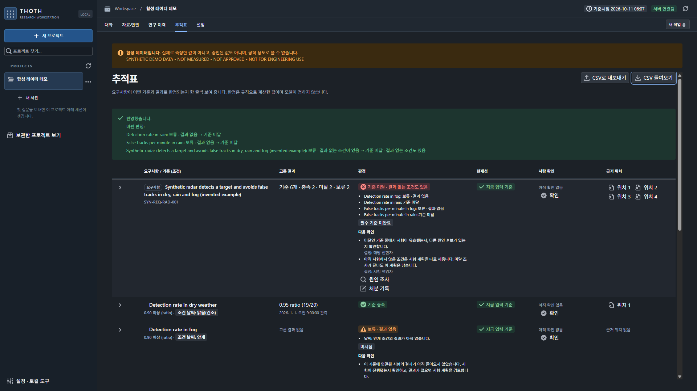
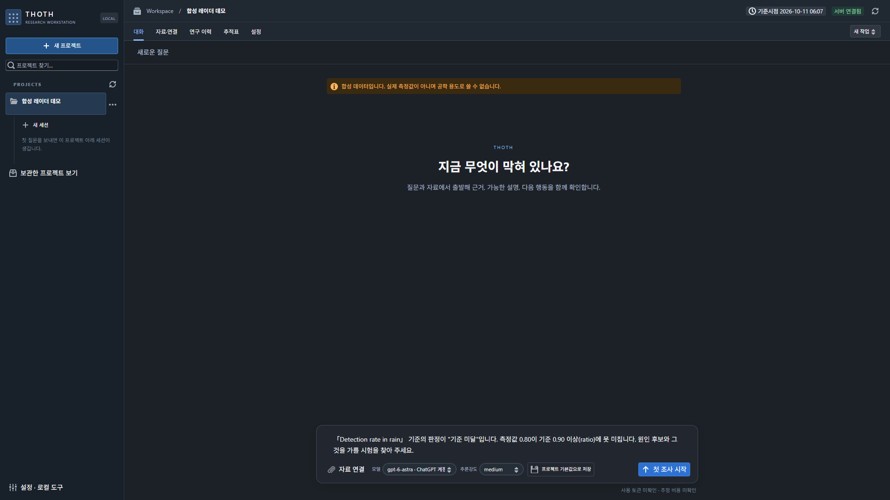
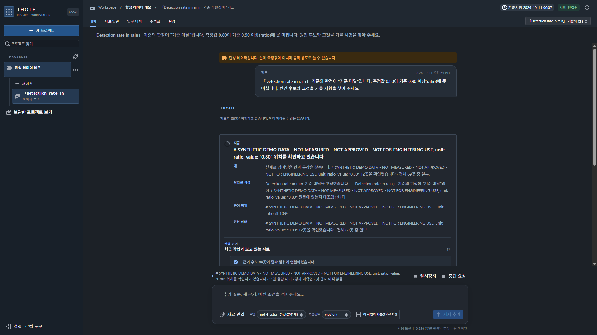
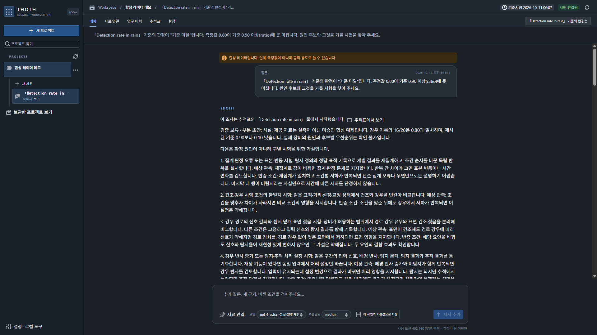
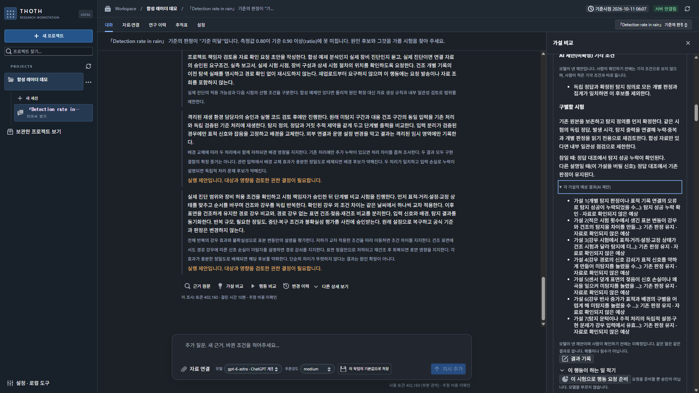
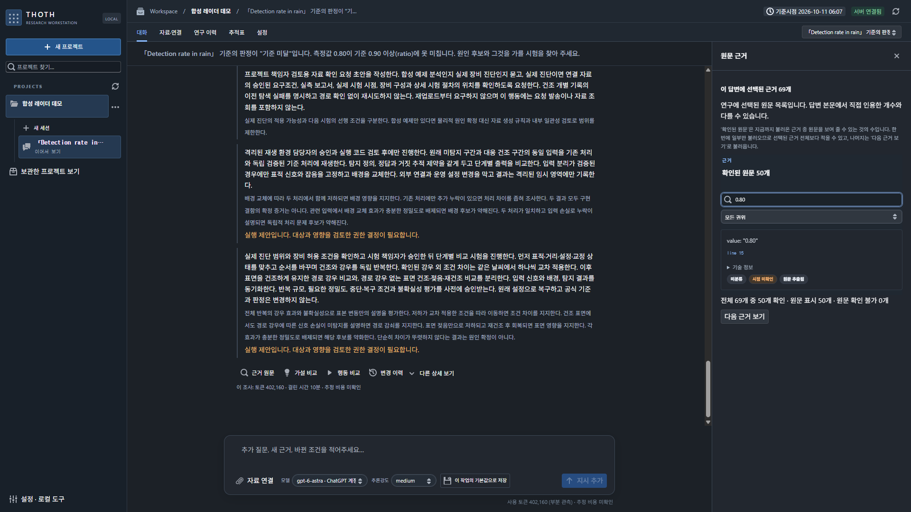

<p align="center">
  
</p>

<h1 align="center">THOTH</h1>

<p align="center">
  <strong>Follow the evidence. Keep the history of your judgment.</strong><br>
  근거를 따라, 판단의 변화를 남기다.
</p>

<p align="center">
  <sub>Meet Toti — a curious little ibis who keeps notes on every clue.</sub>
</p>

<p align="center">
  <a href="LICENSE"></a>
  <a href="#status"></a>
  <a href="docs/INSTALL.md"></a>
</p>

<p align="center">
  <a href="#quick-start">Get started</a> ·
  <a href="#see-it-work">Screens</a> ·
  <a href="#what-you-can-do">Features</a> ·
  <a href="docs/VERIFICATION.md">Verification</a> ·
  <a href="CONTRIBUTING.md">Contribute</a><br>
  <strong>English</strong> · <a href="README.ko.md">한국어</a>
</p>

---

Your documents change. A result gets revised. A colleague needs to understand why.

**THOTH is a local, AI-assisted research workbench that keeps the question, source evidence,
competing explanations and recorded results connected.** Inspect what supports a judgment,
see what remains unresolved, and compare two saved results before deciding what comes next.

> [!NOTE]
> **Experimental source preview for personal/local use.** The interface is Korean-first.
> Focused feature checks passed; the latest repository-wide verification is not passing. See the verification limits below.
> **2026-09-29 update:** isolated model authentication and restart recovery are included. Real-provider analysis and a current-source FULL pass remain unverified. Claude sign-in goes through the official Claude Code executable and has not been checked with a real account.
> **2026-10-11:** one real model investigation on the synthetic radar demo ran end to end ([screens](#see-it-work)). Answer quality has not been evaluated.
> See [status and limits](#status) before relying on a result.

## See it work

A real run on the bundled [synthetic radar demo](examples/synthetic-radar-demo-v1): invented data, not measurements.
One model investigation took about 9 minutes 40 seconds. Screens are from a 2026-10-11 development build, so a few
labels may differ slightly from `main`.

<table>
  <tr>
    <td width="50%"></td>
    <td width="50%"></td>
  </tr>
  <tr>
    <td><b>1 · A result misses its criterion.</b> Import results into the trace table. Verdicts are computed by rules, not by the model: 0.80 against "0.90 or higher" becomes <i>below criterion</i>.</td>
    <td><b>2 · Ask why, from that row.</b> "원인 조사" on the failing row writes the question with the measured value and the criterion.</td>
  </tr>
  <tr>
    <td></td>
    <td></td>
  </tr>
  <tr>
    <td><b>3 · Watch it read your material.</b> Progress names the connected file and line being checked.</td>
    <td><b>4 · Get a held answer, not a guess.</b> Confirmed facts stay apart from the judgment that remains open; each candidate cause comes with a test that could tell it apart.</td>
  </tr>
  <tr>
    <td></td>
    <td></td>
  </tr>
  <tr>
    <td><b>5 · Compare hypotheses.</b> For each test, see what every hypothesis would predict. These are marked as unconfirmed AI suggestions.</td>
    <td><b>6 · Check the source line.</b> Search the evidence panel for "0.80" and land on the exact line of the connected file.</td>
  </tr>
</table>


## What you can do

| Follow the evidence | Inspect the judgment | Keep the changes |
| :--- | :--- | :--- |
| Connect documents and return to source-located evidence, versions and time eligibility. | Review an answer alongside competing explanations, missing evidence and next actions. | Compare two exact saved results and inspect immutable history. Supported restores create a new revision. |

**Continue a question without losing its earlier result.** Queue new input behind running work;
request identity is preserved across retries and recovery.

**Keep unresolved work visible.** A completed operation can still contain a partial answer or a
held judgment. Completion is not a claim that the evidence is sufficient.

**Choose your own connection.** Configure a supported provider login or API key in your local
workspace, then select the model and reasoning setting. Saved choices are preserved; unavailable
routes are shown explicitly. Reading a saved result or comparison does not start a model call.

## A research loop you can revisit

| Step | In THOTH |
| :--- | :--- |
| **1 · Ask** | Start with a research question and connect the relevant documents. |
| **2 · Inspect** | Follow the answer back to evidence; review competing explanations and gaps. |
| **3 · Continue** | Add information or a follow-up question. Input can wait behind running work. |
| **4 · Compare** | Select two saved results to inspect what changed. Revisit history when needed. |

## Quick start

**Windows · source checkout · Python 3.12 or 3.13 · [uv](https://docs.astral.sh/uv/) · Node.js · pnpm**

Clone the repository:

```powershell
git clone https://github.com/hyperdrivebeep/thoth.git
cd thoth
```

Or choose **Code → Download ZIP** on GitHub, extract it, and open PowerShell in the extracted
`thoth-main` folder. If PowerShell is in the folder containing that extraction, run `cd thoth-main`.

**1. Check Python and install the locked dependencies** from the repository folder:

```powershell
$thothPython = Join-Path $env:LOCALAPPDATA 'Programs\Python\Python313\python.exe'
Test-Path -LiteralPath $thothPython
& $thothPython -m venv --copies --without-pip .venv
uv sync --python .\.venv\Scripts\python.exe --no-managed-python --no-python-downloads --frozen --extra dev --dev
pnpm.cmd install --frozen-lockfile
```

If `Test-Path` prints `False`, set `$thothPython` to your installed Python 3.12/3.13
`python.exe` path, or install the official Python first. The signature-checked version of
these steps is in [Prepare Python on Windows](docs/INSTALL.md#prepare-python-on-windows).

**2. Start the API** in one terminal:

```powershell
.\.venv\Scripts\python.exe -m thoth.cli workspace
.\.venv\Scripts\python.exe -m thoth.cli serve --port 8765
```

**3. Start the Web interface** in a second terminal, after entering the same `thoth` or `thoth-main` folder:

```powershell
pnpm.cmd --dir apps/web run dev
```

**4. Connect a model inside the app.** Open **<http://127.0.0.1:5173/>**. The first-run screen
lists ChatGPT, Claude and xAI: choose the sign-in button for a provider, finish the sign-in in your
browser, and THOTH loads that account's model list. Or connect your own provider API key. No
terminal is needed for this step. If a helper program is missing (the Codex CLI for ChatGPT,
Claude Code for Claude), the card offers an automatic install. It needs Node.js, installs into
`%LOCALAPPDATA%\THOTH\tools`, and leaves your global installs and other programs' logins alone.
Manual commands are in [docs/INSTALL.md](docs/INSTALL.md). A sign-in uses the same account's
usage limits as its other apps, and provider use may consume quota.

New Windows installations keep research data in `%LOCALAPPDATA%\THOTH`, independently of the
downloaded source folder. If you used an earlier version, open its existing data directory with
`serve --workspace "C:\path\to\your\old\.thoth-local" --port 8765`.
THOTH reports the selected directory at startup and does not move old data automatically.

Sign-in uses separate THOTH profiles; existing login information from other programs is not
imported. Claude sign-in runs the official Claude Code executable in that profile, and xAI uses
a device-code flow. Both were checked only with fake providers or fake executables (xAI also with a
Chrome/RPC flow); real-account acceptance is pending. See [connection requirements and restart behavior](docs/INSTALL.md).

The API binds to loopback; Vite proxies API calls to port 8765. Keep the migration tree with the
source checkout: a standalone wheel is not supported by this preview.

<details>
<summary><strong>Installation details and optional integrations</strong></summary>

The isolated Windows check used Python 3.13.15, Node 24.19.0, pnpm 12.6.0 and uv 0.12.5.
The basic PDF path uses pypdf. Structured PDF parsing, browser acquisition, additional connectors
and managed sandboxes have optional dependencies and prerequisites.

The default connection does not import credentials from other programs. The experimental Codex
bridge uses its own profile for login, token refresh and model discovery. No account configuration
is distributed here; successful login alone does not establish a successful model response.

See [installation and credentials](docs/INSTALL.md).

</details>

## Status

This is an **experimental reference implementation**, with evidence scoped to the checks below.

| Checked locally | Boundary |
| :--- | :--- |
| Input queue, strict input-version checking and exact-result comparison | Four selected integration tests passed; unchanged comparison UI retains recorded Chrome acceptance. |
| Fresh frozen installation, doctor and Web build | Passed on the recorded Windows environment. |
| Synthetic evidence interface | 36 focused Web tests passed. |
| First-run Chrome/API smoke | Passed with no credentials or model calls. An unconfigured model was expected. |
| 2026-09-28 authentication/restart r2 | Partial independent Chrome/RPC acceptance with synthetic providers; five saved results reopened in another process without model calls. Diagnostic failure and unrun scenarios are documented. |
| Connection/restart Web acceptance after signed Python recovery | 247 Web tests and 8 doctor checks passed; actual Chrome/RPC with fake providers covered setup, saved results, drafts and workspace separation. Real OAuth and physical PC reboot remain unverified. |

**The latest repository-wide verification is not passing.** These results are separate from the focused feature
checks. No complete current-source regression pass is claimed. Some legacy assets are also omitted
because their redistribution rights were not established.

Real-provider answer quality, hosted multi-runtime readiness, broad platform portability and
actual collaborator time savings have not been established by these checks.

[Verification record](docs/VERIFICATION.md) · [Exact known failures](docs/KNOWN_TEST_FAILURES.json) ·
[Package boundary](docs/PACKAGING.md)

## Built to be inspected

| Area | Location |
| :--- | :--- |
| Python backend | [`src/thoth`](src/thoth) — domain → ports → application → adapters; composition under `apps`. |
| React / TypeScript interface | [`apps/web`](apps/web) |
| Canonical records and versioned history | SQLite, with versioned migrations in [`migrations`](migrations). |
| Brand assets and writing style | [`docs/brand`](docs/brand) |

UI summaries do not replace canonical records or authorization. Use synthetic data and an isolated
workspace for reproductions. Contributions should preserve source-time, scope, currentness and
authorization checks. Read the [contributor notes](CONTRIBUTING.md) before opening a change.

## License

Original code, documentation, THOTH brand assets and THOTH-authored synthetic fixtures in this
snapshot are available under the **[MIT License](LICENSE)**, copyright 2026 THOTH.
Dependencies retain their own licenses; see [third-party and asset notices](THIRD_PARTY_NOTICES.md).

<p align="center">
  <br>
  <sub>Evidence. Judgment. Revision.</sub><br>
  <a href="https://github.com/hyperdrivebeep">Built by Hyperdrive</a>
</p>
