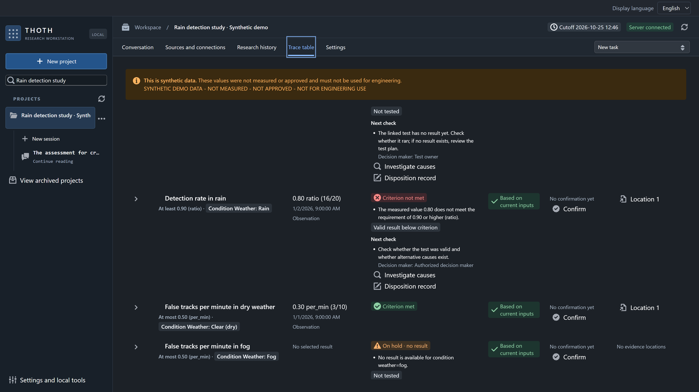
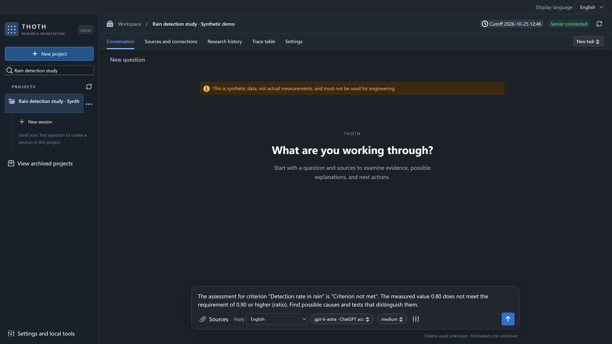
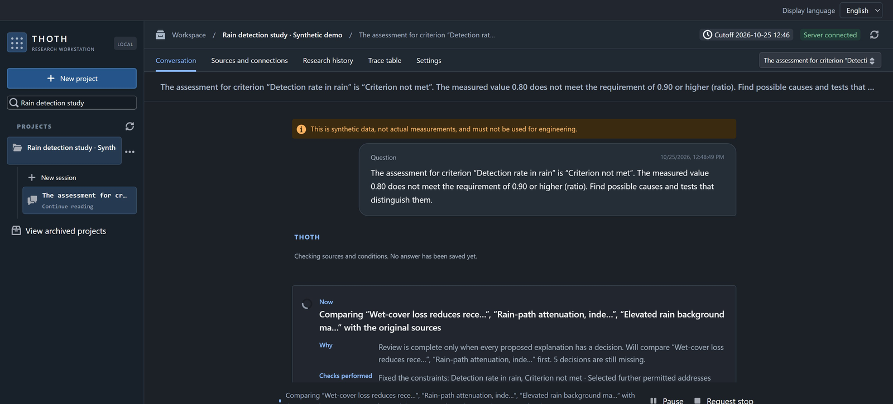
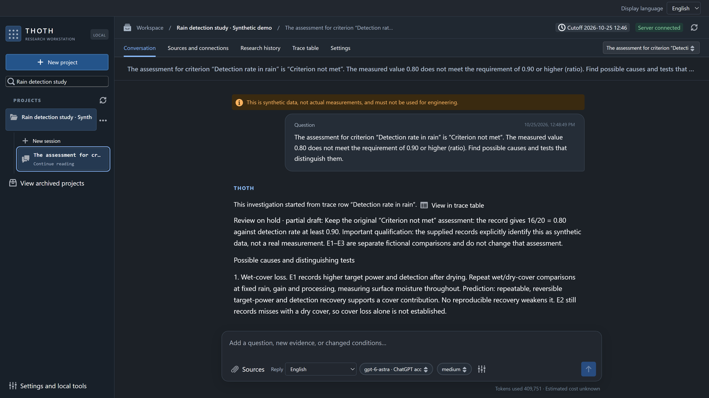
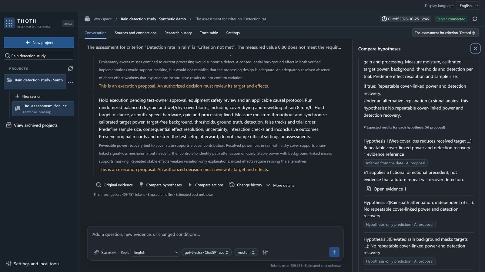
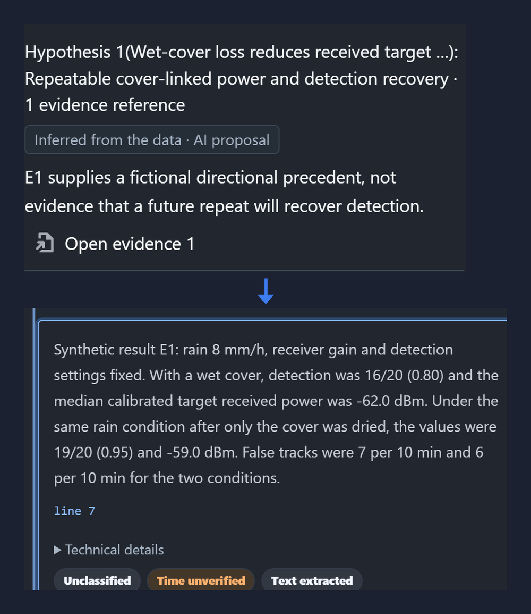
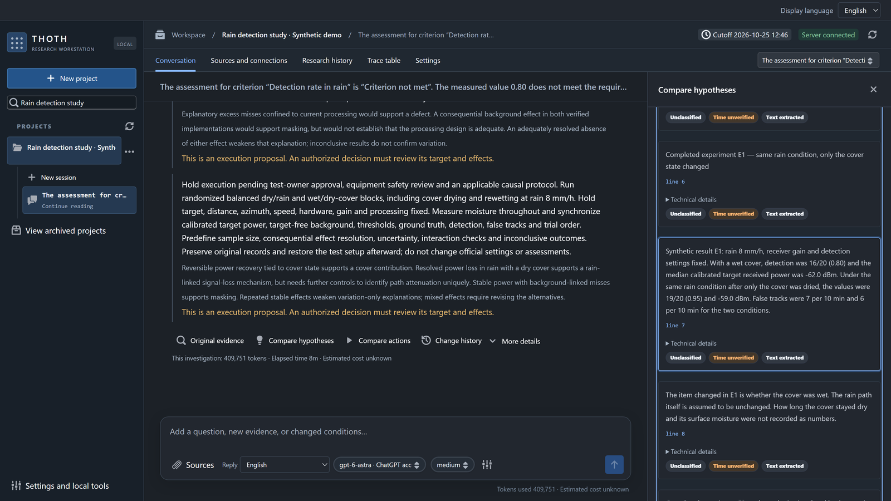

<p align="center">
  
</p>

<h1 align="center">THOTH</h1>

<p align="center">
  <strong>Follow the evidence. Keep the history of your judgment.</strong><br>
  근거를 따라, 판단의 변화를 남기다.
</p>

<p align="center">
  <sub>Meet Toti — a curious little ibis who keeps notes on every clue.</sub>
</p>

<p align="center">
  <a href="LICENSE"></a>
  <a href="#status"></a>
  <a href="docs/INSTALL.md"></a>
</p>

<p align="center">
  <a href="#quick-start">Get started</a> ·
  <a href="#see-it-work">Screens</a> ·
  <a href="#what-you-can-do">Features</a> ·
  <a href="docs/VERIFICATION.md">Verification</a> ·
  <a href="CONTRIBUTING.md">Contribute</a><br>
  <strong>English</strong> · <a href="README.ko.md">한국어</a>
</p>

---

Your documents change. A result gets revised. A colleague needs to understand why.

**THOTH is a local, AI-assisted research workbench that keeps the question, source evidence,
competing explanations and recorded results connected.** Inspect what supports a judgment,
see what remains unresolved, and compare two saved results before deciding what comes next.

> [!NOTE]
> **Experimental source preview for personal/local use.** The interface supports Korean and English.
> GitHub Actions checks the Python suite, Web tests/build and a reviewed Python type-error baseline.
> Recorded synthetic-demo investigations have completed with a real model; this does not establish research quality or usefulness on real data.
> English question, answer and source-text captures are available; broader English quality, real-account coverage and physical PC restart coverage remain incomplete.
> Read [status and limits](#status), [model usage and cost](#model-usage-and-cost), and the [draft security policy](SECURITY.md) before relying on a result.

## See it work

English captures from a 2026-10-25 investigation on the bundled
[synthetic radar demo](examples/synthetic-radar-demo-v1), with an English synthetic completed-experiment
source added. The question, answer and cited source text shown here are in English. These are invented
records, not real measurements or evidence of engineering performance.

<table>
  <tr>
    <td width="50%"></td>
    <td width="50%"></td>
  </tr>
  <tr>
    <td><b>1 · A result misses its criterion.</b> Rules compute the assessment: 0.80 does not meet a requirement of 0.90 or higher.</td>
    <td><b>2 · Ask why, from that row.</b> “Investigate causes” fills in a question with the result and criterion. Sending it starts the investigation.</td>
  </tr>
  <tr>
    <td></td>
    <td></td>
  </tr>
  <tr>
    <td><b>3 · Watch the source review.</b> The progress view names the three candidate explanations being compared with the source documents.</td>
    <td><b>4 · Keep the unresolved judgment visible.</b> The partial answer retains the original assessment and separates possible causes from proposed tests.</td>
  </tr>
  <tr><td colspan="2"></td></tr>
  <tr><td colspan="2"><b>5 · Compare hypotheses.</b> Inspect what a test would predict under different explanations and how each prediction relates to the supplied evidence.</td></tr>
  <tr><td colspan="2" align="center"></td></tr>
  <tr><td colspan="2"><b>6 · Follow an inference to its source.</b> Two captured detail views are arranged here to connect the AI proposal with synthetic experiment E1. The recorded comparison does not prove that a future test will reproduce it.</td></tr>
  <tr><td colspan="2"></td></tr>
  <tr><td colspan="2"><b>7 · Read the evidence in context.</b> Open the source card and its neighboring lines. The synthetic record stays distinct from a verified real-world result.</td></tr>
</table>

## What you can do

| Follow the evidence | Inspect the judgment | Keep the changes |
| :--- | :--- | :--- |
| Connect documents and return to source-located evidence, versions and time eligibility. | Review an answer alongside competing explanations, missing evidence and next actions. | Compare two exact saved results and inspect immutable history. Supported restores create a new revision. |

**Continue a question without losing its earlier result.** Queue new input behind running work;
request identity is preserved across retries and recovery.

**Keep unresolved work visible.** A completed operation can still contain a partial answer or a
held judgment. Completion is not a claim that the evidence is sufficient.

**Choose your own connection.** Configure a supported provider login or API key in your local
workspace, then select the model and reasoning setting. Saved choices are preserved; unavailable
routes are shown explicitly. Reading a saved result or comparison does not start a model call.

**Choose the display and response languages separately.** Changing the display language makes
no model call and preserves saved answers. Each submitted question keeps its response language
through retries and recovery; the next question in the same conversation can use another language.
Older requests retain their original language policy. New questions use model capacity.

## A research loop you can revisit

Expected results and refutation conditions are on by default for projects without a saved
choice. A previously saved off choice stays off. You can change this in the project's advanced
settings. Filling missing predictions may add a model call and use more tokens; predictions
remain unconfirmed proposals, even when they include evidence references.

| Step | In THOTH |
| :--- | :--- |
| **1 · Ask** | Start with a research question and connect the relevant documents. |
| **2 · Inspect** | Follow the answer back to evidence; review competing explanations and gaps. |
| **3 · Continue** | Add information or a follow-up question. Input can wait behind running work. |
| **4 · Compare** | Select two saved results to inspect what changed. Revisit history when needed. |

## Quick start

**Windows · source checkout · Python 3.12 or 3.13 · [uv](https://docs.astral.sh/uv/) · Node.js · pnpm**

Clone the repository:

```powershell
git clone https://github.com/hyperdrivebeep/thoth.git
cd thoth
```

Or choose **Code → Download ZIP** on GitHub, extract it, and open PowerShell in the extracted
`thoth-main` folder. If PowerShell is in the folder containing that extraction, run `cd thoth-main`.

**1. Check Python and install the locked dependencies** from the repository folder:

```powershell
$thothPython = Join-Path $env:LOCALAPPDATA 'Programs\Python\Python313\python.exe'
Test-Path -LiteralPath $thothPython
& $thothPython -m venv --copies --without-pip .venv
uv sync --python .\.venv\Scripts\python.exe --no-managed-python --no-python-downloads --frozen --extra dev --dev
pnpm.cmd install --frozen-lockfile
```

If `Test-Path` prints `False`, set `$thothPython` to your installed Python 3.12/3.13
`python.exe` path, or install the official Python first. The signature-checked version of
these steps is in [Prepare Python on Windows](docs/INSTALL.md#prepare-python-on-windows).

**2. Start the API** in one terminal:

```powershell
.\.venv\Scripts\python.exe -m thoth.cli workspace
.\.venv\Scripts\python.exe -m thoth.cli serve --port 8765
```

**3. Start the Web interface** in a second terminal, after entering the same `thoth` or `thoth-main` folder:

```powershell
pnpm.cmd --dir apps/web run dev
```

**4. Connect a model inside the app.** Open **<http://127.0.0.1:5173/>**. The first-run screen
lists ChatGPT, Claude and xAI: choose the sign-in button for a provider, finish the sign-in in your
browser, and THOTH loads that account's model list. Or connect your own provider API key. No
terminal is needed for this step. If a helper program is missing (the Codex CLI for ChatGPT,
Claude Code for Claude), the card offers an automatic install. It needs Node.js, installs into
`%LOCALAPPDATA%\THOTH\tools`, and leaves your global installs and other programs' logins alone.
Manual commands are in [docs/INSTALL.md](docs/INSTALL.md). A sign-in uses the same account's
usage limits as its other apps, and provider use may consume quota.

New Windows installations keep research data in `%LOCALAPPDATA%\THOTH`, independently of the
downloaded source folder. If you used an earlier version, open its existing data directory with
`serve --workspace "C:\path\to\your\old\.thoth-local" --port 8765`.
THOTH reports the selected directory at startup and does not move old data automatically.
One workspace is used by one THOTH process at a time; a second start on the same workspace stops
with a message (exit code 3) until the first one is closed.

LOCAL workspaces on detected sync, network, or Windows/WSL shared folders are refused (exit 4).
Unclassified locations need explicit confirmation (exit 5); removable drives carry a warning.
Use `thoth workspace` to inspect the selected path and read the
[location policy and confirmation commands](docs/INSTALL.md#workspace-location-policy).

Sign-in uses separate THOTH profiles; existing login information from other programs is not
imported. Claude sign-in runs the official Claude Code executable in that profile, and xAI uses
a device-code flow. Both were checked only with fake providers or fake executables (xAI also with a
Chrome/RPC flow); real-account acceptance is pending. See [connection requirements and restart behavior](docs/INSTALL.md).

The API binds to loopback; Vite proxies API calls to port 8765. Keep the migration tree with the
source checkout: a standalone wheel is not supported by this preview.

<details>
<summary><strong>Installation details and optional integrations</strong></summary>

The isolated Windows check used Python 3.13.15, Node 24.19.0, pnpm 12.6.0 and uv 0.12.5.
The basic PDF path uses pypdf. Structured PDF parsing, browser acquisition, additional connectors
and managed sandboxes have optional dependencies and prerequisites.

The default connection does not import credentials from other programs. The experimental Codex
bridge uses its own profile for login, token refresh and model discovery. No account configuration
is distributed here; successful login alone does not establish a successful model response.

See [installation and credentials](docs/INSTALL.md).

</details>

## Model usage and cost

Recorded synthetic-demo investigations used about **8–9 model calls and 330,000–450,000 tokens per
investigation**, mostly input tokens. This is an observed range, not an estimate for every question;
source volume, model behavior and follow-up work can change it.

ChatGPT/Codex sign-in consumes the account's subscription usage allowance. An API-key connection is
billed by its provider according to token usage and the applicable rates. THOTH does not quote a fixed
price. Check the usage line beneath a saved result: missing or partial usage stays marked as such,
and a displayed estimate is not a provider invoice. See [usage and cost details](docs/INSTALL.md#model-usage-and-cost).

## Status

This is an **experimental source preview**. Verification is tied to a source revision and a specific scenario.

| Evidence | What it establishes |
| :--- | :--- |
| Latest merged check reviewed here: [PR #25](https://github.com/hyperdrivebeep/thoth/pull/25), 2026-10-25 | Its [CI run](https://github.com/hyperdrivebeep/thoth/actions/runs/40156740267) finished with 5,828 Python tests passed, zero failures/errors and two skipped cases. Web tests, lint, type checks, build and the quick-start smoke check also passed. This run passed on its first attempt; it does not erase earlier failures on other revisions. |
| Python static types | CI rejects diagnostics outside the reviewed baseline. Existing baseline entries are still known diagnostics; a passing job does not mean the code is free of type errors. |
| Real-model synthetic demonstrations | Investigations have completed with saved answers, expected-result tables and evidence references. Synthetic inputs and a completed operation do not validate the scientific conclusions. |
| Sign-in and recovery | Some connection and saved-result reopening paths have been checked. Claude and xAI real-account acceptance and physical PC reboot coverage remain incomplete; see [installation and restart notes](docs/INSTALL.md). |
| Intermittent test failures | Some timing-sensitive tests fail under load. A later individual pass does not erase the original failure; stabilization work remains. |

The Korean and English captures show completed synthetic investigations. The English capture used an
explicit English response choice and an English source file. This demonstrates the recorded scenario,
not broad English answer quality. Changing the display language does not translate your source documents.

Answer quality, usefulness on real data, hosted multi-runtime readiness, broad platform portability and
collaborator time savings have not been established. Some legacy assets are omitted because their
redistribution rights were not established.

[Verification record](docs/VERIFICATION.md) · [Historical selected-failure ledger](docs/KNOWN_TEST_FAILURES.json) ·
[Known limitations](docs/KNOWN_LIMITATIONS.md) · [Package boundary](docs/PACKAGING.md)

## Built to be inspected

| Area | Location |
| :--- | :--- |
| Python backend | [`src/thoth`](src/thoth) — domain → ports → application → adapters; composition under `apps`. |
| React / TypeScript interface | [`apps/web`](apps/web) |
| Canonical records and versioned history | SQLite, with versioned migrations in [`migrations`](migrations). |
| Brand assets and writing style | [`docs/brand`](docs/brand) |

UI summaries do not replace canonical records or authorization. Use synthetic data and an isolated
workspace for reproductions. Contributions should preserve source-time, scope, currentness and
authorization checks. Read the [contributor notes](CONTRIBUTING.md) before opening a change.

## License

Original code, documentation, THOTH brand assets and THOTH-authored synthetic fixtures in this
snapshot are available under the **[MIT License](LICENSE)**, copyright 2026 THOTH.
Dependencies retain their own licenses; see [third-party and asset notices](THIRD_PARTY_NOTICES.md).

<p align="center">
  <br>
  <sub>Evidence. Judgment. Revision.</sub><br>
  <a href="https://github.com/hyperdrivebeep">Built by Hyperdrive</a>
</p>
